<picture>
  <source media="(prefers-color-scheme: dark)" srcset="./header-dark.svg">
  
</picture>

Staff Software Engineer at **ServiceNow**. I build backend systems, and the test and build infrastructure that lets teams ship them safely.

     

## Changelog

> All notable changes to this engineer are documented below. The format follows Keep a Changelog; the versions follow the calendar.

### `v2026.02` Staff Software Engineer · ServiceNow · _Latest_
Feb 2026 – now · Amsterdam

**Added**
- Platform analytics: Performance Analytics, Charts and Analytics.
- Dashboards, components and APIs in Java and PostgreSQL.
- Developer-productivity tools for the org.

**Fixed**
- Performance problems across the analytics stack.

### `v2024.05` Into feature development · ServiceNow · _Breaking_
May 2024 – Feb 2026 · Senior Software Engineer

**Changed**
- Lateral move from quality engineering to product work. The testing habits were kept as a dependency.

### `v2023.02` Staff Software Engineer, Quality Engineering Lead · ServiceNow
Feb 2023 – May 2024

**Added**
- Quality for 3 teams and 5 quality engineers: test strategy, coverage and the gates in CI.

<b>Older releases</b>: Backbase, Zendesk, Concrete Solutions, garoaQA, HR Tech, education

### `v2021.02` Amsterdam: Backbase, then ServiceNow · _Relocated_
Senior SE, Automation · Backbase Feb – Jun 2021 · ServiceNow Jul 2021 – Feb 2023

**Added**
- XCUITest and Espresso suites for the Backbase mobile business banking app; release team; test-tool proofs of concept.
- Two UTG awards at ServiceNow in 2022 (Q1 and Q2).

**Changed**
- Maintained `25k+` automated tests and migrated the legacy test framework.
- Moved coverage to component tests, which cut E2E runs and the wait for results.

### `v2018.09` Dublin: Zendesk · _Relocated_
Sep 2018 – Jan 2021 · Software Engineer, Automation → Senior (Jan 2020)

**Added**
- Espresso and EarlGrey suites for the Zendesk Support mobile app.
- Ruby tools for CI and developer productivity; Ansible for the CI machines.
- Test-first coaching for the team; ownership of the regression cycles.

**Fixed**
- Held `99.6%+` crash-free sessions, release after release.

### `v2015.09` São Paulo: Concrete Solutions (now Accenture)
Sep 2015 – Jul 2018 · Software Engineer, Automation → Senior (May 2016) → Automation Lead (Nov 2016)

**Added**
- Mobile and API test automation for client projects with Calabash, Ruby and JavaScript.
- Living documentation with Cucumber and specification by example; visual regression testing.
- Lead of the automation practice from 2016.

### `v2015.00` Co-founded garoaQA
2015 – 2024 · Community

**Added**
- A Brazilian QA community that grew to `1,600+` members, with 11 coordinators in 5 states.
- Testing track coordination at The Developer's Conference; talks on Appium, Calabash and RestAssured with companion repos.
- Runs and writes for [Assert Quality Assurance](https://medium.com/assertqualityassurance).

### `v2014.06` First job: Software Engineer, HR Tech
Jun 2014 – Sep 2015 · São Paulo

**Added**
- Web and mobile: an Android app, warehouse software and e-commerce, in Java and JavaScript.

### `v2013.00` Initial commit on GitHub
101 repositories since

**Added**
- [ansible_qa_playbook](https://github.com/wellavelino/ansible_qa_playbook) provisions a full QA machine.
- [image-comparable](https://github.com/wellavelino/image-comparable) and element_screenshot do visual regression in Ruby; snapshot-ios-poc does it on iOS.
- Forks and contributions to Appium, Calabash, Espresso (kappuccino), RESTMock, fastlane, bluepill and Kontrast.

### `v0.1.0` Systems Analysis (IT), Centro Universitário Senac
2012 – 2017

## Side projects

Products I design, build, test and run in production on my own, in TypeScript, Python and Swift, and with AI agents.

| Package | What it does | Built with |
|---|---|---|
| **besparro** private · demo on request | Grocery price comparison across 13 Dutch supermarket chains. A nightly ETL fills Postgres, product matching and search run on pgvector, and an AI basket optimizer finds the cheapest mix of stores. End-to-end tests and verify gates protect production. | Next.js, NestJS, PostgreSQL + pgvector, Redis / BullMQ, Playwright |
| **framewise** private · iOS | An iOS camera that picks the best crop and aspect ratio live, on device. A MobileNetV3 + RoIAlign model ranks crops with SRCC 0.775, against 0.40 for the baseline. | Swift, Core ML, PyTorch, StoreKit 2 |
| **harness** private | Multi-role AI orchestration: one model plans, a second implements and escalates, a third executes, all driven headless through the Claude Code CLI with retries and replans. | TypeScript, Node, LLM agents |
| [**sentinel**](https://github.com/wellavelino/sentinel) open source | A Claude Code plugin with a live progress panel for every agent and subagent, and a highlighter that marks the key phrases in each reply using a second model. | TypeScript, Plugin API |
| [**frameo-dashboard**](https://github.com/wellavelino/frameo-homeassistant-dashboard) open source · ★ 34 | A fast wall dashboard for a Frameo photo frame or an Android tablet: a kiosk APK and a vanilla JS app on the Home Assistant websocket, plus energy automations for dynamic tariffs and EV charging. | JavaScript, Android, Python, Home Assistant |
| **prepsio** private · in pilot | Reads a nutritionist's meal-plan PDF, scanned ones included, and turns it into a weekly menu, a shopping list and a meal-prep plan. | TypeScript, Prisma, OCR, LLM extraction |
| **se-informe** private · civic tech | A Portuguese-language site about Brazilian Congress members and their public spending, from official sources, with links to the receipts and CSV export. | Python, open data |

## Stack

| | |
|---|---|
| **Languages** | Java · TypeScript & Node · Go · Python · Ruby · Swift · Kotlin · Rust · Lua |
| **Testing & quality** | Playwright · Selenium · Appium · Espresso · XCUITest · EarlGrey · Calabash · Cucumber · RestAssured · RSpec · Jest · visual regression · contract tests |
| **Backend & data** | NestJS · FastAPI · Gin · PostgreSQL · pgvector · Redis · BullMQ · Prisma · ETL |
| **Build, CI & infra** | GitHub Actions · Jenkins · Docker · Ansible · Nginx · Cloudflare · Proxmox · fastlane |
| **AI & ML** | LLM agent orchestration · Claude API · evals · embeddings · PyTorch · Core ML |
| **Mobile** | iOS & SwiftUI · Android · kiosk apps · mobile security |

## House rules

1. **Nothing ships unverified.** Static checks, unit, integration and end-to-end tests gate every push. After each deploy I test the change live.
2. **Name the commit that broke it.** Every bug fix starts with a failing test and finds the change that introduced the bug.
3. **Beat the baseline, in numbers.** A model or heuristic ships only when it beats the simple version on measurements, never on impressions.
4. **Agents get roles, reviews and budgets.** Each model has a clear job, with review and cost limits, so AI adds speed without losing quality.

## Maintainer

Backend, platform and quality engineering. Write to me on [LinkedIn](https://www.linkedin.com/in/wellington-avelino/), read [Assert Quality Assurance](https://medium.com/assertqualityassurance), or find me as [@wellavelino](https://twitter.com/wellavelino).

Languages: Portuguese, English · Based in Amsterdam
